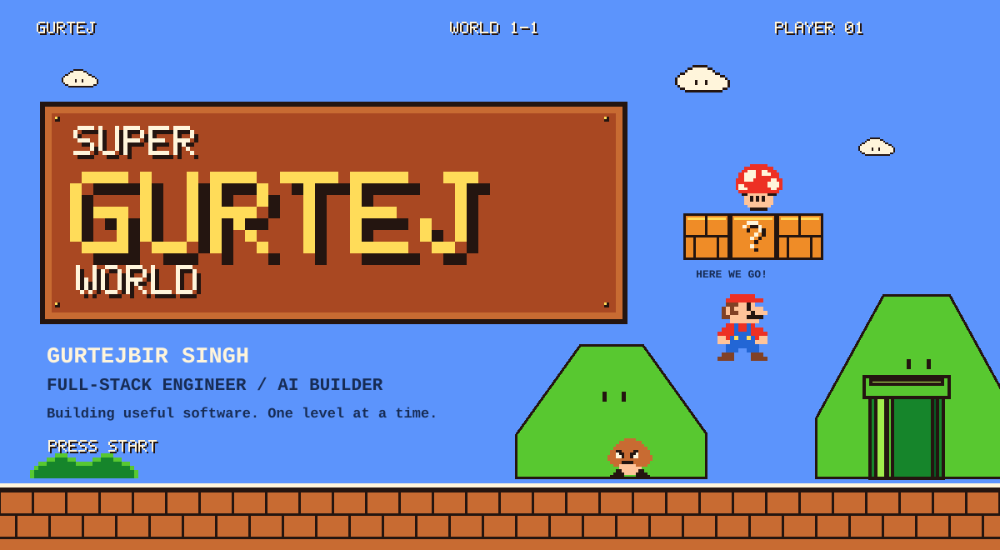
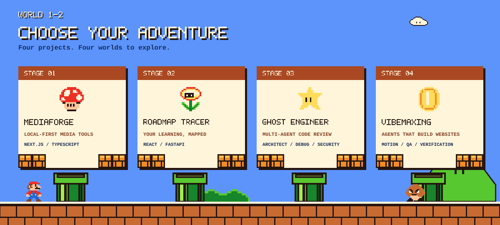
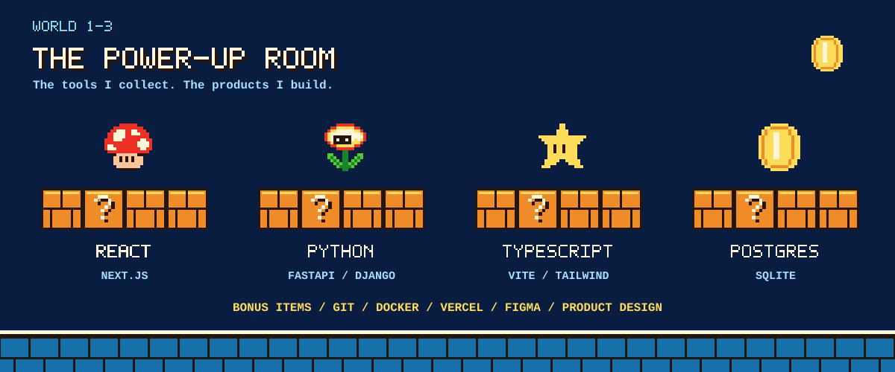
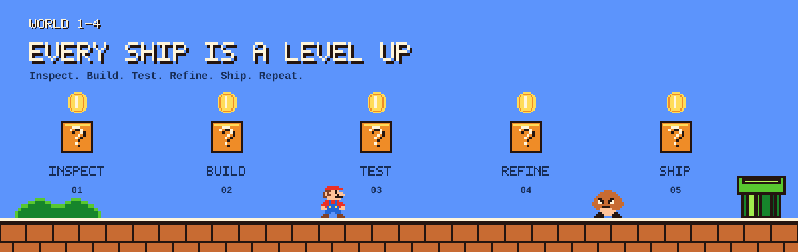
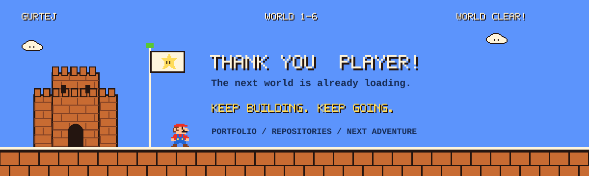

  

  <a href="https://gurtejbirsingh.vercel.app/"><b>▶ START — PORTFOLIO</b></a>
  &nbsp;&nbsp;·&nbsp;&nbsp;
  <a href="https://github.com/Gurtejhundal?tab=repositories"><b>▦ LEVEL SELECT — REPOSITORIES</b></a>

  I’m <b>Gurtejbir Singh</b>. I turn messy workflows into useful, shipped software. 
  Product systems · developer tools · local-first software · purposeful interfaces 
  <b>CURRENT QUEST</b> &nbsp; Deeper systems · stronger product execution · consistent DSA practice

 

  <a href="https://github.com/Gurtejhundal/MediaForge"><b>① MEDIAFORGE</b></a>
  &nbsp;·&nbsp;
  <a href="https://github.com/Gurtejhundal/Roadmap-Tracer"><b>② ROADMAP TRACER</b></a>
  &nbsp;·&nbsp;
  <a href="https://github.com/Gurtejhundal/Ghost-Engineer"><b>③ GHOST ENGINEER</b></a>
  &nbsp;·&nbsp;
  <a href="https://github.com/Gurtejhundal/VibeMaxing"><b>④ VIBEMAXING</b></a>

 

 

 

  
  
<code>REAL CONTRIBUTIONS · DAILY AUTO-SAVE · KEEP MOVING RIGHT</code>

  
The README level plays itself. Want the controls? <a href="./game/">Get the playable Mario mini-game →</a>

 

  

  <a href="https://gurtejbirsingh.vercel.app/"><b>[ A ] ENTER PORTFOLIO</b></a>
  &nbsp;&nbsp;·&nbsp;&nbsp;
  <a href="https://github.com/Gurtejhundal?tab=repositories"><b>[ B ] NEXT ADVENTURE</b></a>

Made with a love of building and a little Mushroom Kingdom magic. Unofficial fan art. Mario and Super Mario are Nintendo trademarks.

